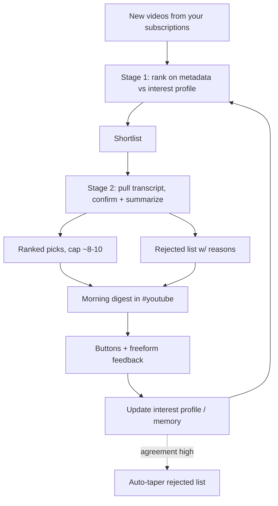

# aivo — Personal AI Assistant (Concept)

A personal AI assistant ("chief of staff") living in Discord, built as a new homectl
app. This document captures the **concept and functionality only** — technical and
architecture decisions (Node 24 + Express, `pi.dev`, storage, auth, deployment, and how
it slots into `homectl-infra` / `homectl-auth`) are deliberately deferred to a separate
technical pass.

> Status: concept locked for review. Phase planning to follow.

## Core identity

- **One conversational agent.** A single Discord persona that both answers you and
  proactively messages you. All capabilities (YouTube digest, later mail, reminders) are
  *tools* of this one agent — not separate bots. The architecture should keep the option
  open to split later, but the mental model is one assistant.
- **General-purpose + capabilities.** You can ask it anything (like ChatGPT) *and* it has
  homectl capabilities. It gains "tools" over time rather than being a narrow command bot.
- **Persistent, inspectable memory.** It remembers facts, preferences, and ongoing context
  across conversations. You can ask "what do you remember about me?" and "forget that."
  The YouTube interest profile and (later) mail-importance profile are slices of this
  broader memory.
- **Persona.** Concise, dry, direct — a competent chief-of-staff that doesn't pad replies
  and asks before doing anything ambiguous. Editable later via an in-chat system prompt
  ("be more casual").
- **Bounded proactivity.** It only messages you unprompted from defined capabilities: the
  daily digest, (later) important mail, and reminders you set. Open-ended "AI decides to
  ping you" stays OFF until trust is built.

## Interface — Discord

- **Discord-only for v1.** No web UI yet (gives mobile + desktop for free; chat-native
  fits a personal assistant).
- **Private single-member server with per-capability channels:** `#chat` (general
  conversation), `#youtube` (digest + feedback). `#mail` added in phase 2.
- **Household-ready by design.** v1 is just you, but the agent should attribute messages
  per-person so household members can be invited later without a redesign.

## v1 centerpiece — YouTube daily digest

### Discovery + filter

- Source: your **actual YouTube subscriptions** (all new videos since the last digest),
  then filtered down — not everything is included. **v1 is subscriptions-only.**
- **Two-stage filter:**
  - Stage 1 (cheap): rank by title + description + channel against your interest profile
    to produce a shortlist.
  - Stage 2 (rich): for the shortlist, pull the transcript to confirm relevance and write
    the summary.

### Discovery beyond subscriptions — considered, deferred (revisit later)

- Goal: surface "the videos I'd scroll into" (YouTube's recommended / "up next" sidebar).
- **Hard constraint:** YouTube's official API does **not** expose personalized
  recommendations, the "related videos" sidebar, or watch history. The `relatedToVideoId`
  search parameter was deprecated/removed on Aug 7, 2023; there is no supported
  replacement.
- Future options if/when we revisit:
  - **Interest-based search (official, ToS-safe):** run searches derived from the interest
    profile + videos you engage with. A proxy for "related to my interests," not YouTube's
    exact algorithm. Note: `search.list` is quota-heavy (~100 units/call).
  - **Unofficial scraping (e.g. yt-dlp): UNDESIRED / ruled out.** Could reproduce the real
    sidebar with no quota, but violates YouTube ToS and is fragile. Do not pursue.
- If added later, it would be a **separate "Discovery" lane** alongside Subscriptions,
  gated by the same feedback loop, with liked discoveries promotable to subscriptions.

### Interest profile

- Seeded by a one-time **conversational onboarding** in Discord — the agent interviews you
  and writes an editable, human-readable natural-language profile. It evolves via feedback.

### Delivery & format

- **Once daily, morning (~07:00 local), configurable via chat.** Single batch covering
  everything new since the last digest.
- **Ranked cap ~8–10 picks**, expandable on request ("6 more matched, lower confidence").
- **Each entry:** thumbnail + title + channel + duration + link, a 2–3 bullet **TL;DW**
  content summary (from the stage-2 transcript), and a one-line **"why you're seeing this."**

### Feedback loop (the priority)

- **Quick reactions/buttons** on each video (keep / drop, "too long", "wrong topic")
  *plus* **freeform replies** ("stop showing me X channel's shorts"). Both fold into the
  interest profile.
- **Cold-start calibration (first ~1–2 weeks):** the digest shows its picks *and* a short
  **rejected list** with one-line reasons ("skipped: news recap, you said no"). You correct
  in both directions so the agent learns the *boundary*, not just positives. As your
  agreement rate rises, the rejected list **auto-tapers** to only borderline calls.

## Cost control (v1, first-class concern)

Essentially all variable cost is **LLM token usage** (chat, the digest's two-stage filter,
and especially transcript summarization). YouTube Data API is free but quota-capped (a rate
limit, not a bill); transcripts and hosting are cheap/fixed. So control = managing **how
many tokens, at what model price, how often.**

- **Model tiering (biggest lever), configurable in chat.** Cheap/small model for
  high-volume cheap tasks (stage-1 ranking, later mail classification); premium model only
  for final TL;DW summaries + real conversation. Adjustable on demand ("use the cheap model
  for everything this week").
- **Budget model:** monthly **hard ceiling** + configurable **daily soft cap** +
  **threshold alerts** at ~50/80/100%. Numbers set in chat ("set my monthly budget to 15").
- **Behavior at limit — graceful degradation in stages:** (1) drop to cheaper models +
  shorter summaries, (2) pause proactive/non-essential work (digests), but **always keep
  answering direct chat** (with an "over budget" note) so it never goes fully dark.
- **Volume guards:** the ranked cap (~8–10) bounds how many transcripts get expensive
  stage-2 treatment; very long transcripts are truncated/chunked so one outlier can't blow
  up a day.
- **Approval gate for expensive one-offs:** estimate cost and confirm before any single
  on-demand request exceeds a user-set threshold (e.g. > $0.50 / > N tokens). Routine cheap
  work proceeds silently.
- **Usage reporting:** end-of-day report early on (today's spend, month-to-date vs budget,
  biggest drivers) that **auto-tapers to weekly** once you're comfortable; always available
  on demand ("what have I spent?"); threshold alerts fire regardless.
- **Provider-side backstop (technical pass):** set a hard spend limit on the inference
  provider account/key so even a bug can't run away.

## Reminders (v1)

- User-set reminders ("remind me to call X at 5") delivered proactively. Part of the
  bounded-proactivity set.

## Phase 2 — Mail triage (concept locked, build later)

- **Read-only triage to start.** Reads and classifies importance; **alerts immediately** on
  important mail; **end-of-day summary** of the rest. No sending/replying/archiving yet
  (drafting can come later once classification is reliable).
- **Reuses the YouTube pattern:** conversational "what counts as important to you" profile
  + button/freeform feedback + boundary calibration.
- **Asymmetric-cost bias:** missing an important email is worse than a false alert, so
  cold-start **errs toward over-alerting** — it alerts liberally early, and the end-of-day
  summary says "I alerted you on these; tell me which weren't worth it," so you safely tune
  it *down* rather than risk misses.

## Phasing (to be detailed later)

- **v1:** Discord private server (`#chat` + `#youtube`); general-purpose agent;
  persistent/inspectable memory; conversational onboarding; YouTube daily digest (two-stage
  filter, TL;DW, ranked cap, button + freeform feedback, cold-start rejection-list
  calibration); user-set reminders; cost control (model tiering, budget caps + alerts,
  graceful degradation, approval gate, usage reports).
- **Phase 2:** Mail triage (read-only) in a `#mail` channel.
- **Phase 3+:** Household members (per-person attribution/profiles); optional web dashboard
  (browsing/feedback history); Discovery lane (interest-based official search only; scraping
  ruled out) per the constraints above.

## Open items deferred (by request)

- Technical stack (Node 24 + Express, `pi.dev`), data storage, auth, deployment, and how
  this slots into `homectl-infra` / `homectl-auth` — to be planned in a separate technical
  pass.
- Exact budget figures and per-task cost numbers — depend on the chosen inference
  provider/model; pinned down in the technical pass. All cost-control mechanisms above are
  provider-agnostic.
