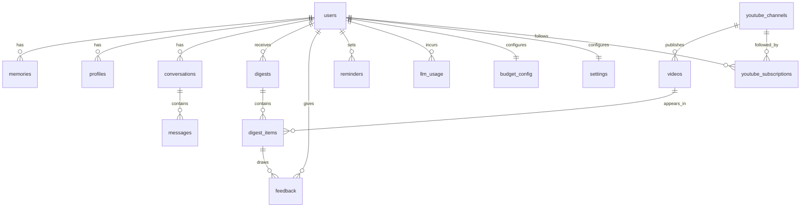

# aivo — Data Model (Draft)

> Status: **draft for review** (technical pass). Companion to
> [`concept.md`](concept.md), [`technical-overview.md`](technical-overview.md),
> and [`deployment.md`](deployment.md). Nothing here is built yet — this is a
> proposed schema to react to.

## Approach

- **Storage:** the shared homectl Postgres 17 instance, a dedicated database +
  user `aivo` (provisioned by the Terraform `applications` map — see
  [`deployment.md`](deployment.md)). No object storage bucket in v1 (YouTube
  thumbnails are hotlinked).
- **Access layer:** `pg` Pool + typed **Kysely**, plain-SQL migrations run at
  boot (homectl pattern #3). Schema types live in `backend/src/db/schema.ts`.
- **Identity seam:** v1 is Discord-only, so a user is keyed by their Discord
  user id. We keep a nullable `auth_sub` column so homectl-auth (and a later web
  dashboard) can attach without a migration — this is the same JIT-user seam
  `workbench` uses, minus the OAuth flow for now.
- **Conventions:** `snake_case` columns, `uuid` primary keys (server-generated)
  except where an external id is the natural key, `timestamptz` everywhere,
  `created_at` / `updated_at` on mutable rows. JSON payloads validated with Zod
  in app code, not the DB.

## Entity-relationship overview

## Tables

### `users`
The household-ready identity row. v1 has exactly one, but every other table
keys off `users.id` so members can be added later without redesign.

- `id` uuid pk
- `discord_user_id` text unique not null — the v1 identity
- `auth_sub` text unique null — reserved for homectl-auth (phase 3)
- `display_name` text
- `is_owner` boolean default false — distinguishes the primary user early on
- `created_at`, `updated_at` timestamptz

> Provisioned just-in-time: on the first message from an unknown Discord id,
> upsert a row (mirrors `workbench`'s `upsertByAuthSub`).

### `settings`
Per-user, chat-editable knobs (one row per user).

- `user_id` uuid pk → users
- `digest_hour` int default 7, `timezone` text default `Europe/Oslo`
- `digest_cap` int default 8 — ranked picks cap (~8–10)
- `model_tier` text default `auto` — `auto` | `cheap` | `premium` (the chat
  override "use the cheap model for everything this week")
- `persona_prompt` text null — editable system-prompt addendum ("be more casual")
- `proactivity` jsonb — which proactive lanes are enabled (digest, reminders)
- `updated_at` timestamptz

### `memories`
The persistent, **inspectable** memory ("what do you remember about me?" /
"forget that"). The interest/importance profiles are higher-level summaries
derived alongside this.

- `id` uuid pk
- `user_id` uuid → users
- `category` text — e.g. `preference`, `fact`, `context`
- `content` text not null — human-readable
- `source` text — `onboarding` | `chat` | `feedback` | `inferred`
- `embedding` vector null — optional, only if we enable semantic recall (pgvector)
- `pinned` boolean default false, `forgotten_at` timestamptz null — soft-delete so
  "forget that" is reversible and auditable
- `created_at`, `updated_at`

### `profiles`
Versioned natural-language profiles (the YouTube interest profile; later the mail
importance profile). Human-readable and chat-editable; kept versioned so feedback
evolution is traceable.

- `id` uuid pk
- `user_id` uuid → users
- `kind` text — `youtube_interest` | `mail_importance`
- `body` text not null — the editable NL profile
- `version` int — incremented on each material update
- `is_current` boolean — exactly one current per (user, kind)
- `created_at`

### `conversations` / `messages`
Chat context per channel, enough to give the agent memory of the running thread
and to attribute spend.

`conversations`
- `id` uuid pk, `user_id` uuid → users
- `channel` text — `chat` | `youtube` | `mail` | `dm`
- `discord_channel_id` text
- `created_at`, `last_message_at`

`messages`
- `id` uuid pk, `conversation_id` uuid → conversations
- `role` text — `user` | `assistant` | `tool` | `system`
- `discord_message_id` text null — links assistant output to a Discord message
  (needed to attach reaction buttons / edit later)
- `content` text
- `tokens_in` int, `tokens_out` int null
- `created_at`

### `youtube_channels`
Cache of subscribed channels (v1 is subscriptions-only).

- `id` text pk — YouTube channel id
- `title` text, `thumbnail_url` text
- `muted` boolean default false — from feedback ("stop showing me X channel")
- `last_seen_at` timestamptz

### `youtube_subscriptions`
Which user follows which channel (join; supports per-person digests later).

- `user_id` uuid → users
- `channel_id` text → youtube_channels
- `created_at`
- pk (`user_id`, `channel_id`)

### `videos`
Candidate videos discovered from subscriptions, carrying both filter stages.

- `id` text pk — YouTube video id
- `channel_id` text → youtube_channels
- `title` text, `description` text, `duration_seconds` int
- `published_at` timestamptz, `thumbnail_url` text
- `stage1_score` real null, `stage1_at` timestamptz null
- `transcript_status` text — `none` | `fetched` | `unavailable`
- `stage2_decision` text null — `keep` | `reject`
- `summary` text null — the 2–3 bullet TL;DW (from stage-2 transcript)
- `why` text null — one-line "why you're seeing this"
- `created_at`

### `digests` / `digest_items`
A digest run and its entries. `digest_items` distinguishes **picks** from the
**rejected list** (with reasons) that drives cold-start boundary calibration.

`digests`
- `id` uuid pk, `user_id` uuid → users
- `run_date` date, `status` text — `pending` | `delivered` | `skipped_budget`
- `covers_since` timestamptz — watermark of "new since last digest"
- `delivered_at` timestamptz null
- `token_cost_cents` int default 0

`digest_items`
- `id` uuid pk, `digest_id` uuid → digests, `video_id` text → videos
- `kind` text — `pick` | `reject`
- `rank` int null — for picks
- `reason` text null — for rejects ("skipped: news recap, you said no")
- `confidence` real null

### `feedback`
Reactions + freeform replies folded back into profiles/memory. Both the button
signals (keep/drop, too long, wrong topic) and NL replies land here.

- `id` uuid pk, `user_id` uuid → users
- `digest_item_id` uuid null → digest_items — null for global feedback
- `signal` text — `keep` | `drop` | `too_long` | `wrong_topic` | `freeform`
- `freeform_text` text null
- `applied` boolean default false — set once folded into a profile/memory update
- `created_at`

### `reminders`
User-set reminders delivered proactively.

- `id` uuid pk, `user_id` uuid → users
- `text` text, `due_at` timestamptz
- `status` text — `pending` | `delivered` | `cancelled`
- `delivered_at` timestamptz null
- `created_at`

### `llm_usage`
Per-call cost ledger — the basis for budget caps, alerts, and usage reports.
(All variable cost is LLM tokens; this is the cost-control source of truth.)

- `id` uuid pk, `user_id` uuid → users
- `task_type` text — `chat` | `stage1_rank` | `stage2_summary` | `onboarding` |
  `mail_classify` (phase 2)
- `model` text, `tokens_in` int, `tokens_out` int
- `cost_cents` real
- `created_at` timestamptz
- indexed on (`user_id`, `created_at`) for daily/monthly rollups

### `budget_config`
Per-user budget settings (one row per user).

- `user_id` uuid pk → users
- `monthly_ceiling_cents` int — hard ceiling
- `daily_soft_cap_cents` int null
- `alert_thresholds` jsonb default `[50,80,100]`
- `degradation_state` text — `normal` | `cheap_models` | `proactive_paused`
- `updated_at`

> Daily/month-to-date spend is **derived** from `llm_usage` (a view or rollup),
> not stored, so reports and threshold checks can't drift from the ledger.

## Cross-cutting notes

- **The learning loop** (`videos.stage1_score` → `digest_items` picks/rejects →
  `feedback` → `profiles`/`memories` → next run's stage-1 ranking) is the whole
  point; the rejected list auto-tapers as agreement rises, which is a query over
  recent `feedback` agreement rate, not a stored flag.
- **No FKs to YouTube ids across user data** beyond the cache tables; the video
  cache can be pruned independently of digests (keep `videos` rows referenced by
  any `digest_item`).
- **Soft deletes** for `memories` ("forget") and `reminders`/`digests`
  (`status`) keep the agent's actions auditable and reversible.
- **pgvector is optional** — only add the `embedding` column + extension if we
  decide semantic memory recall beats keyword/recency retrieval in v1.

## Open questions

- Do we want semantic memory (pgvector) in v1, or start with simple
  category/recency retrieval and add embeddings later?
- Should `conversations`/`messages` retain full history indefinitely, or roll up
  old threads into `memories` and prune (cost + privacy)?
- Per-user vs per-household budget: v1 is one user, but `budget_config` is keyed
  per user — confirm that's the right granularity when household lands.
