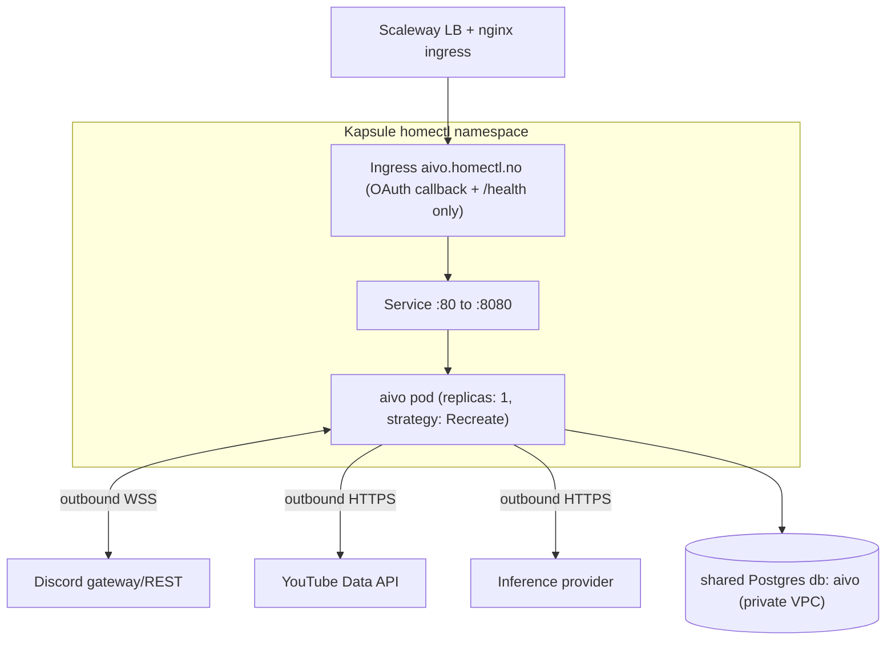

# aivo — Deployment Architecture (Draft)

> Status: **draft for review** (technical pass). Companion to
> [`concept.md`](concept.md), [`technical-overview.md`](technical-overview.md),
> and [`data-model.md`](data-model.md). Follows the homectl-reference platform
> conventions; **all infra is Terraform-managed in `homectl-infra` — never create
> cloud resources or edit `*-terraform-secrets` by hand.**

## App identity

The app id is `aivo` (kebab-case, load-bearing). It is the Postgres db + user,
the secret prefix, and the k8s resource names. Repo name = app id.

- App id / DB / user: `aivo`
- Subdomain (only for the OAuth callback + health): `aivo.homectl.no`
- Bucket: **none** in v1 (thumbnails hotlink from YouTube)

## Where aivo runs

Kapsule (managed k8s), `homectl` namespace, `fr-par`, behind the shared nginx
ingress + cert-manager — the canonical homectl runtime. Image lives at
`rg.fr-par.scw.cloud/homectl/aivo:<sha>`.

The important difference from a typical homectl app: aivo is a **stateful,
single-instance worker** (one Discord gateway connection + one scheduler), not a
horizontally-scalable web service.



Note most traffic is **outbound** (the gateway WebSocket, YouTube, inference).
The ingress exists only for the rare inbound need: the YouTube OAuth callback and
external health visibility.

## Terraform: the `applications` map

Register aivo in `homectl-infra/terraform/variables.tf` by adding one line to the
`applications` map default (template:
`homectl-reference/templates/terraform/application-entry.tf`):

```hcl
variable "applications" {
  default = {
    # ...existing apps...
    aivo = { postgres = true }   # database + user "aivo"; no bucket
  }
}
```

Then, from `homectl-infra/terraform/` (a deliberate, user-approved step):

```bash
terraform plan    # expect: new DB "aivo", user, and aivo-terraform-secrets
terraform apply
```

This provisions the Postgres database + non-admin user and a k8s Secret
`aivo-terraform-secrets` containing `DATABASE_URL`. No bucket / S3 keys (we set
`bucket` unset/false).

## Secrets model

| Secret | Managed by | Holds |
|--------|-----------|-------|
| `aivo-terraform-secrets` | Terraform (**do not edit**) | `DATABASE_URL` |
| `aivo-secrets` | Hand-managed (`kubectl create secret`) | `DISCORD_BOT_TOKEN`, `DISCORD_APP_ID`, `DISCORD_GUILD_ID`, `YOUTUBE_API_KEY`, `YOUTUBE_OAUTH_CLIENT_ID`, `YOUTUBE_OAUTH_CLIENT_SECRET`, `YOUTUBE_OAUTH_REFRESH_TOKEN`, `LLM_API_KEY`, `LLM_BASE_URL`, model ids, `OWNER_DISCORD_USER_ID` |

Both are consumed via `envFrom` (the hand-managed one `optional: true`);
hand-managed values override Terraform ones on key conflicts. Plaintext secrets
never enter git — committed env overlays document keys only.

Create the hand-managed secret once:

```bash
kubectl -n homectl create secret generic aivo-secrets \
  --from-literal=DISCORD_BOT_TOKEN=... \
  --from-literal=YOUTUBE_API_KEY=... \
  --from-literal=LLM_API_KEY=... \
  # ...etc
```

## Kubernetes manifest

Derived from `homectl-reference/templates/k8s/deployment.yml`, with three
deliberate changes for a singleton worker:

- **`replicas: 1`** — only one gateway connection / scheduler may exist.
- **`strategy: { type: Recreate }`** — never run old+new pods together (a rolling
  deploy would briefly double the gateway + scheduler). Accept a few seconds of
  downtime on deploy.
- **Drop the S3 env block** (no bucket).
- **Probes** target `/health`; readiness reflects "DB reachable & gateway
  connected." Keep a generous `startupProbe` (migrations run at boot).

Sketch (full file to be written during scaffolding):

```yaml
apiVersion: apps/v1
kind: Deployment
metadata:
  name: aivo
  namespace: homectl
spec:
  replicas: 1
  strategy:
    type: Recreate
  selector:
    matchLabels:
      app: aivo
  template:
    metadata:
      labels:
        app: aivo
    spec:
      containers:
        - name: aivo
          image: rg.fr-par.scw.cloud/homectl/aivo:$IMAGE_TAG
          ports:
            - containerPort: 8080
          envFrom:
            - secretRef:
                name: aivo-terraform-secrets
            - secretRef:
                name: aivo-secrets
                optional: true
          startupProbe:
            httpGet: { path: /health, port: 8080 }
            failureThreshold: 30
            periodSeconds: 10
          readinessProbe:
            httpGet: { path: /health, port: 8080 }
            initialDelaySeconds: 5
            periodSeconds: 10
          livenessProbe:
            httpGet: { path: /health, port: 8080 }
            initialDelaySeconds: 30
            periodSeconds: 20
          resources:
            requests: { cpu: 100m, memory: 384Mi }
            limits: { memory: 768Mi }
---
# Service :80 -> :8080, plus an Ingress for aivo.homectl.no
# (only routes the OAuth callback + /health; everything else is outbound).
```

Service + Ingress mirror the template (`aivo.homectl.no`, cert-manager
`letsencrypt-prod`, class `nginx`).

### Do we even need the ingress?

Two options for the one inbound need (YouTube OAuth consent → refresh token):

- **A (recommended): keep a minimal ingress.** Expose `aivo.homectl.no` so the
  YouTube OAuth `redirect_uri` resolves in the cluster. One-time consent, then the
  stored `YOUTUBE_OAUTH_REFRESH_TOKEN` is reused; the route can also serve a
  status page later.
- **B: no ingress.** Do the OAuth dance locally once, paste the resulting refresh
  token into `aivo-secrets`. Simpler infra, but manual re-auth if the token is
  revoked.

Recommendation: **A** — it's the standard homectl shape and unblocks a future web
dashboard, at the cost of one Ingress object.

## Scheduling: in-process vs k8s CronJob

The daily digest (~07:00 local) and reminder delivery need a timer.

- **In-process `node-cron` (recommended).** With `replicas: 1` there's exactly
  one scheduler; it shares the gateway connection and DB pool, and the
  `digests.run_date` watermark makes runs idempotent across restarts. Simplest,
  fewest moving parts.
- **k8s CronJob.** A separate pod that pokes the service. Cleaner separation but
  needs an internal trigger endpoint and duplicates config/secrets; overkill for a
  singleton.

Recommendation: **in-process**, revisit only if scheduling needs grow.

## CI/CD

Standard homectl pipeline using the templates
(`homectl-reference/templates/github-workflows/{ci.yaml,deploy.yml}`):

- **CI (`ci.yaml`):** install (with GitHub Packages token), typecheck, test, build
  image on PRs/main.
- **Deploy (`deploy.yml`):** on green CI on main → build → push to
  `rg.fr-par.scw.cloud/homectl/aivo:<sha>` → `kubectl apply` of `k8s/deployment.yml`
  with `$IMAGE_TAG` substituted → `kubectl rollout status`.
- **Required repo secrets:** `SCW_ACCESS_KEY`, `SCW_SECRET_KEY`,
  `SCW_ORGANIZATION_ID`, `SCW_PROJECT_ID`, `K8S_CLUSTER_ID` (+ built-in
  `GITHUB_TOKEN` for `read:packages`).
- Migrations run at container boot before the server/gateway start.

## Cost backstop (infra-level)

Beyond the in-app budget controls (see
[`technical-overview.md`](technical-overview.md)), set a **hard spend limit on the
inference provider account/key** so even a bug cannot run away. This is the
last-line guard the concept calls for.

## Operational notes

- **Single point of failure is acceptable** for a personal assistant; a crash
  self-heals via the Deployment restarting the pod, and the gateway reconnects.
- **Deploys cause brief downtime** (Recreate). Fine for v1; messages sent during
  the gap are recoverable from Discord history on reconnect if needed.
- **Backups:** rely on the shared Postgres instance's backup policy in
  `homectl-infra`; aivo holds the only durable state (no bucket).

## Open questions

- Confirm option A vs B for the YouTube OAuth callback / ingress.
- Resource limits: is 384Mi/768Mi enough headroom for transcript + LLM payload
  handling, or bump memory?
- Do we want a separate low-traffic alert path (e.g. budget 100% hit) beyond the
  Discord message itself?
