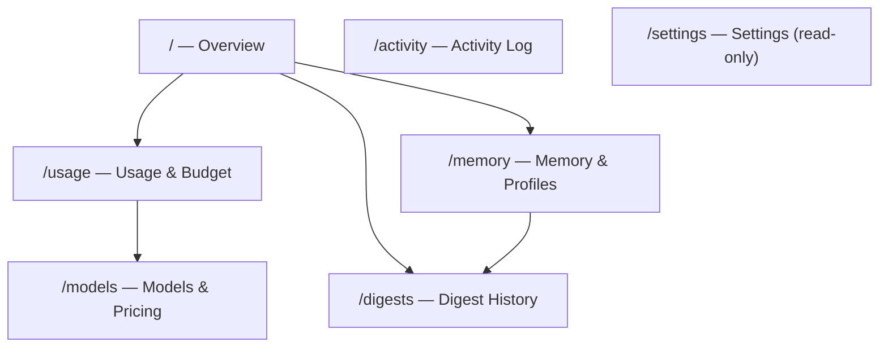
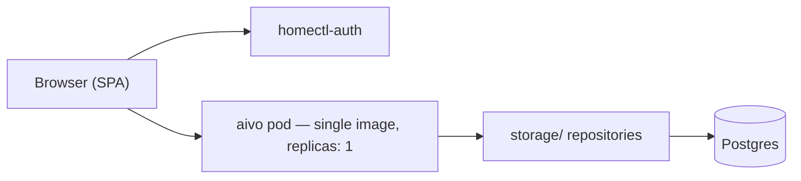

# aivo — Phase 3: Web Dashboard (PRD)

> Status: **draft — product requirements for implementation planning.** Expands
> roadmap step 5 ([`roadmap.md`](roadmap.md) § Phase 3) into actionable scope for
> a later technical design pass. Companion docs: [`concept.md`](concept.md),
> [`data-model.md`](data-model.md), [`technical-overview.md`](technical-overview.md),
> [`feature-suggestions.md`](feature-suggestions.md) (C8).

## 1. Summary

### 1.1 Problem

Aivo v1 is Discord-native. All interaction, configuration, and inspection happen in
chat. The backend persists rich operational data — LLM spend, model pricing, memories,
conversation history, digest runs — but there is no visual surface to explore it.
Today, a user can ask "what do you remember?" or run `!budget`, but cannot see
trends, compare models, or browse memory at scale.

### 1.2 Solution

A small **read-first web dashboard** that complements Discord (does not replace it).
The dashboard exposes existing Postgres data through a new HTTP API and presents it
in interactive charts and browsable views. Discord remains the primary control plane;
the web UI is for **inspection, trust, and pattern recognition**.

### 1.3 Relationship to Phase 3 roadmap

Roadmap step 5 bundles two concerns:

1. **Household** — per-person attribution and profiles (schema already supports this
   via `users.id`; YouTube stays owner-scoped permanently).
2. **Web dashboard** — this document.

This PRD covers **(2) in detail** and notes household implications where they affect
the UI. Household member onboarding itself is out of scope here; the dashboard must
**not block** on it (single-owner v1 must work).

### 1.4 Success criteria

- An authenticated owner can open the dashboard and understand LLM spend, configured
  models, and stored memories without using Discord.
- All v1 dashboard pages are **read-only**; writes stay in Discord/agent tools until
  a later phase.
- No duplication of business logic — API handlers delegate to existing repositories
  in `backend/src/storage/`.
- Dashboard ships as a separate `frontend/` workspace in the monorepo, but **one Docker
  image** with the backend (same homectl app pattern as workbench): the backend serves
  the built SPA, Discord gateway, scheduler, and dashboard API routes behind homectl-auth.

---

## 2. Goals and non-goals

### 2.1 Goals

| ID | Goal |
|----|------|
| G1 | Visualize LLM usage and budget state with interactive time-series and breakdown charts |
| G2 | Show active model configuration, tier mapping, and per-model usage share |
| G3 | Browse, search, and inspect Aivo's memory and versioned profiles |
| G4 | Provide a home overview with key KPIs and system health |
| G5 | Integrate homectl-auth so only authenticated household users see their data |
| G6 | Enable a future implementation agent to derive an API + frontend plan from this doc alone |
| G7 | Dashboard is fully usable on mobile phone browsers, not just desktop |

### 2.2 Non-goals (Phase 3 dashboard v1)

- Replacing Discord as the primary interface for chat, settings changes, or owner mutations
- Real-time streaming of agent turns (polling or manual refresh is acceptable)
- pgvector / semantic memory visualization (v1 memory is keyword/category only)
- Mobile-native app (responsive web is sufficient — see §5.5 for mobile requirements)
- Multi-provider LLM routing UI
- YouTube OAuth flow in the dashboard (stays as one-time HTTP callback)
- Write paths for model pricing, budget caps, or memory (deferred; see §7.3)
- Household member invite/onboarding flow (separate workstream; dashboard filters by `user_id` when ready)

---

## 3. Users and permissions

### 3.1 Personas

| Persona | Description | Dashboard access |
|---------|-------------|------------------|
| **Owner** | Primary user (`users.is_owner = true`). Connects YouTube, sets budget, owns digest. | Full read access to own data + owner-scoped YouTube/digest views |
| **Household member** (future) | Additional users in the Discord server. Per-user memory, chat, budget. | Read access to **own** data only; shared YouTube digest is read-only on owner's lane |
| **Unauthenticated** | — | No access; redirect to homectl-auth |

### 3.2 Auth integration

- Use **homectl-auth** (browser OAuth), matching other homectl apps.
- Map auth subject → `users.auth_sub` (column already reserved in migration 001).
- JIT provisioning: on first login, link or create a `users` row (mirror workbench's
  `upsertByAuthSub` pattern).
- v1 dashboard may ship with **owner-only** gate (`is_owner` check) before household
  filters are needed; document this as an explicit milestone toggle.

### 3.3 Authorization rules

| Resource | Rule |
|----------|------|
| `llm_usage`, `budget_config`, `settings`, `memories`, `conversations`, `messages` | Scoped to authenticated user's `user_id` |
| `digests`, `digest_items`, `feedback`, `profiles` (youtube_interest) | Owner user only (YouTube is permanently owner-scoped) |
| `youtube_account`, `youtube_channels` | Owner only; read metadata, no token exposure |
| `model_pricing` | Readable by all authenticated users; **writes owner-only via Discord today** |
| `pending_approvals` | Own user only |

Enforce in API route handlers, not in the frontend.

---

## 4. Product scope — pages and features

### 4.1 Information architecture

Primary navigation: Overview, Usage & Budget, Models, Memory & Profiles, Digests,
Activity Log, Settings.

---

### 4.2 Page: Overview (`/`)

**Purpose:** At-a-glance health and KPIs with links into detail pages.

**Requirements:**

| ID | Requirement | Priority |
|----|-------------|----------|
| O-1 | Display today's spend (fractional cents, formatted for humans) | P0 |
| O-2 | Display month-to-date spend and % of monthly ceiling | P0 |
| O-3 | Show current `degradation_state` with plain-language explanation | P0 |
| O-4 | Show count of active memories and date of most recent memory write | P1 |
| O-5 | Show last digest run: date, status, cost, pick count | P1 |
| O-6 | Show service health: DB reachable, Discord gateway connected (extend `/health` concept) | P1 |
| O-7 | Quick links to Usage, Memory, Digests detail pages | P0 |

**Data sources:** `LlmUsageRepository.todayCents`, `monthToDateCents`;
`BudgetConfigRepository`; `MemoryRepository.listActive` (count); `DigestRepository`;
gateway adapter status (new lightweight probe).

---

### 4.3 Page: Usage & Budget (`/usage`)

**Purpose:** Interactive visualization of LLM spend — the highest-value first page
(per [`feature-suggestions.md`](feature-suggestions.md) C8).

**Requirements:**

| ID | Requirement | Priority |
|----|-------------|----------|
| U-1 | **Burn-down chart:** MTD cumulative spend vs. monthly ceiling; horizontal lines at alert thresholds (default 50%, 80%, 100%) | P0 |
| U-2 | **Time series:** daily spend over selectable range (7d / 30d / MTD / custom); toggle total vs. stacked by model vs. stacked by task type | P0 |
| U-3 | **Breakdown table/chart:** top spend drivers grouped by (model, task_type) with cost and call count — same semantics as `LlmUsageRepository.topDrivers()` | P0 |
| U-4 | **Token mix:** tokens in vs. tokens out over time (aggregated daily) | P1 |
| U-5 | Display budget config: monthly ceiling, daily soft cap, approval threshold, alert thresholds | P0 |
| U-6 | Display degradation state machine stage and what it means for behavior | P0 |
| U-7 | Filter by task type: `chat`, `stage1_rank`, `stage2_summary`, `profile_update` (extensible for future types) | P1 |
| U-8 | Export current view as CSV (usage rows or daily aggregates) | P2 |

**Chart types:** line (burn-down, time series), stacked bar or treemap (breakdown),
optional donut (task type share).

**Data sources:**

- `llm_usage` table (authoritative ledger; spend is always `SUM(cost_cents)`, never
  stored rollups)
- `budget_config` table
- Existing repo methods: `todayCents`, `monthToDateCents`, `spendSinceCents`,
  `topDrivers`
- **New repo methods needed:** daily aggregates by date, optional grouping dimensions;
  time-bucketed series for charts (implementation agent to design)

**Display notes:**

- Costs are **fractional cents** in the ledger; caps are **whole cents**. Format
  consistently (e.g. show dollars/euros with 4 decimal places or round at display only).
- UTC day/month boundaries match v1 repo behavior (`date_trunc` in SQL).

---

### 4.4 Page: Models & Pricing (`/models`)

**Purpose:** Inspect configured models, tier roles, and how usage distributes across
models. Superset of Discord `!models`.

**Requirements:**

| ID | Requirement | Priority |
|----|-------------|----------|
| M-1 | Table of active models: `model_id`, `tier_role` (cheap/premium), input/output price (¢/Mtok), currency | P0 |
| M-2 | Show tier resolution: which model is currently assigned to cheap vs. premium | P0 |
| M-3 | Show user's `settings.model_tier` preference (`auto` / `cheap` / `premium`) and effective tier after budget degradation | P0 |
| M-4 | Usage share chart: spend and call count per model (from `llm_usage`, MTD or selectable range) | P1 |
| M-5 | Explain cost formula: `(tokens_in × input_¢/Mtok + tokens_out × output_¢/Mtok) / 1_000_000` | P2 |
| M-6 | Link to Usage page filtered by model | P2 |

**Data sources:**

- `model_pricing` via `ModelPricingRepository.listActive`, `getByTier`
- `settings.model_tier` via `SettingsRepository`
- `budget_config.degradation_state` (may force cheap tier)
- `llm_usage` aggregates by model

**Non-goals:** Owner write actions (`set_price`, `set_tier_role`) stay in Discord/agent
`models` tool for v1.

---

### 4.5 Page: Memory & Profiles (`/memory`)

**Purpose:** Inspect what Aivo remembers — the inspectable memory promise from
[`concept.md`](concept.md).

**Requirements:**

| ID | Requirement | Priority |
|----|-------------|----------|
| ME-1 | List active memories: category, content, source, created date, pinned badge | P0 |
| ME-2 | Full-text search across memory content (same ILIKE semantics as `MemoryRepository.search`, including wildcard escaping) | P0 |
| ME-3 | Filter by category: `preference`, `fact`, `context` | P0 |
| ME-4 | Sort: pinned first, then recency (matches prompt injection order in `agent/context.ts`) | P1 |
| ME-5 | Show prompt injection hint: "N of M active memories are injected into context" where N = min(active count, `AGENT_MEMORY_INJECT_LIMIT`) | P1 |
| ME-6 | **Profiles tab:** current `youtube_interest` profile body (owner only) | P1 |
| ME-7 | **Profiles tab:** version history with diff between consecutive versions | P2 |
| ME-8 | **Forgotten tab:** soft-deleted memories (`forgotten_at` set) for audit | P2 |
| ME-9 | Category breakdown: count per category, sparkline of additions over time | P2 |

**Data sources:**

- `memories` via `MemoryRepository.listActive`, `search`; new method for forgotten list
- `profiles` via `ProfileRepository` (current + history by kind)
- Config: `AGENT_MEMORY_INJECT_LIMIT` env (expose as read-only API field, not raw env)

**Non-goals for v1:** Pin/edit/forget from web (roadmap polish item A4; defer writes).

---

### 4.6 Page: Digest History (`/digests`) — owner only

**Purpose:** Inspect YouTube digest pipeline output and cost per run.

**Requirements:**

| ID | Requirement | Priority |
|----|-------------|----------|
| D-1 | List digest runs: `run_date`, status, `covers_since`, `cost_cents`, `delivered_at` | P1 |
| D-2 | Drill into a run: picks vs. rejects, linked video metadata, confidence, reasons | P1 |
| D-3 | Show run-level cost (from `digests.cost_cents`, rolled up from `llm_usage`) | P1 |
| D-4 | Feedback summary per run: keep/drop/too_long/wrong_topic counts | P2 |
| D-5 | YouTube connection status: account title, last subscription sync, last video poll | P2 |

**Data sources:** `digests`, `digest_items`, `videos`, `feedback`, `youtube_account`,
`youtube_channels`.

---

### 4.7 Page: Activity Log (`/activity`)

**Purpose:** Inspect agent conversation history and tool usage for debugging and trust.

**Requirements:**

| ID | Requirement | Priority |
|----|-------------|----------|
| A-1 | List conversations by channel (`chat`, `youtube`, `mail`) with last message time | P1 |
| A-2 | Message thread view: user/assistant/tool/system roles, content, timestamps | P1 |
| A-3 | Show per-message `tokens_in`/`tokens_out` where present (informational; not billing) | P2 |
| A-4 | Highlight tool call messages (role = `tool`) | P2 |
| A-5 | List pending approvals: estimated cost, task type, status, created time | P2 |

**Data sources:** `conversations`, `messages`, `pending_approvals`.

**Note:** Full history retention is v1 policy; pagination is required for large threads.

---

### 4.8 Page: Settings (`/settings`) — read-only

**Purpose:** Single view of chat-editable settings without allowing web edits in v1.

**Requirements:**

| ID | Requirement | Priority |
|----|-------------|----------|
| S-1 | Display digest schedule: hour, timezone, interval/cap, proactivity flags | P1 |
| S-2 | Display persona prompt snippet (truncated with expand) | P2 |
| S-3 | Display model tier preference | P1 |
| S-4 | Display budget caps (cross-link to Usage page) | P1 |
| S-5 | Indicate "change via Discord" for all fields | P0 |

**Data sources:** `settings`, `budget_config`.

---

## 5. Technical constraints (for implementation planning)

### 5.1 Architecture

**Repo layout:** separate workspaces, one deployable unit.

- **`frontend/`** — Vite + React (or equivalent homectl stack). Own package, lint, and
  build. No Discord or DB imports.
- **`backend/`** — Express server, Discord gateway, scheduler, dashboard API routes.
  Serves the built SPA as static files (fallback to `index.html` for client routing).

**Deployment:** same as other homectl apps — **one Docker image, one k8s Deployment**.
The Dockerfile builds both workspaces (frontend static assets copied into the backend
image, mirroring the workbench two-stage pattern). There is no separate frontend
deploy or second ingress.

Aivo keeps **`replicas: 1`** and **`strategy: Recreate`** because of the Discord
gateway and in-process scheduler. That is acceptable for the dashboard too: deploys
cause brief downtime, which is fine for a personal inspection UI.

**Ingress:** existing `aivo.homectl.no` ingress expands to serve the dashboard SPA,
dashboard API (`/api/dashboard/*`), homectl-auth callback, YouTube OAuth callback,
and `/health` — all from the same pod.

**Backend routes:** authenticated REST under e.g. `/api/dashboard/`. Reuse existing
repositories; add query methods only where charts need aggregates not yet exposed.

**Layering:** dashboard routes live in `backend/src/routes/` (or a `dashboard/` module);
they must not import discord.js types into agent code. Auth middleware resolves
`user_id` and passes it to handlers.

**No business logic in frontend** beyond presentation, filtering, and chart mapping.

### 5.2 Existing code to reuse

| Concern | Location |
|---------|----------|
| Usage ledger | `backend/src/storage/llmUsageRepository.ts` |
| Budget | `backend/src/storage/budgetConfigRepository.ts` |
| Model pricing | `backend/src/storage/modelPricingRepository.ts` |
| Memory | `backend/src/storage/memoryRepository.ts` |
| Settings | `backend/src/storage/settingsRepository.ts` |
| Profiles | `backend/src/storage/profileRepository.ts` |
| Digests | `backend/src/storage/digestRepository.ts` |
| Budget snapshot logic | `backend/src/agent/budget.ts` (`loadBudgetSnapshot`, degradation) |
| Model resolution | `backend/src/agent/prepareTurn.ts` (`resolveModel`) |
| Discord equivalents | `backend/src/discord/commands.ts` (`!budget`, `!models`) |
| Agent tool equivalents | `backend/src/agent/tools/budget.ts`, `memory.ts`, `models.ts` |

### 5.3 API design principles

- RESTful JSON; consistent error shape.
- All list endpoints paginated (`cursor` or `offset/limit`).
- Date ranges as ISO 8601 query params; default to MTD for spend views.
- Money returned as structured objects: `{ cents: number, formatted: string }` to avoid
  float bugs (ledger values may be fractional).
- OpenAPI or typed client generation recommended for frontend consumption.

### 5.4 Suggested API surface (illustrative — implementation agent refines)

| Method | Path | Purpose |
|--------|------|---------|
| GET | `/api/dashboard/overview` | KPI bundle for home page |
| GET | `/api/dashboard/usage/summary` | today, MTD, ceiling, degradation |
| GET | `/api/dashboard/usage/series` | time-bucketed spend (`?groupBy=model\|task_type`) |
| GET | `/api/dashboard/usage/drivers` | top drivers since date |
| GET | `/api/dashboard/models` | active pricing + tier mapping + user preference |
| GET | `/api/dashboard/models/usage` | per-model aggregates |
| GET | `/api/dashboard/memories` | list/search active memories |
| GET | `/api/dashboard/memories/forgotten` | soft-deleted (P2) |
| GET | `/api/dashboard/profiles/:kind` | current + history |
| GET | `/api/dashboard/digests` | run list |
| GET | `/api/dashboard/digests/:id` | run detail with items |
| GET | `/api/dashboard/conversations` | conversation list |
| GET | `/api/dashboard/conversations/:id/messages` | paginated messages |
| GET | `/api/dashboard/settings` | read-only settings bundle |
| GET | `/api/dashboard/health` | gateway + DB status |

### 5.5 Frontend UX principles

- Clean, data-dense layout suitable for a personal ops tool (not marketing site).
- Interactive charts: hover tooltips, legend toggles, date range picker.
- Empty states with guidance ("No usage yet — start a chat in #chat").
- **Desktop-first, mobile-usable.** Optimized for desktop/laptop screens, but every
  page must remain fully usable on a phone browser:
  - Responsive layouts that reflow on narrow viewports (no horizontal-only layouts).
  - Touch-friendly tap targets and spacing (min ~44px for interactive controls).
  - Navigation that works on small screens (e.g. collapsible sidebar or bottom nav).
  - Charts and tables readable on mobile: scrollable tables, simplified chart legends,
    or stacked/card layouts where a wide desktop table would not fit.
  - No hover-only interactions; tooltips accessible via tap where needed.
- Manual refresh or 60s polling; no WebSocket requirement for v1.

---

## 6. Delivery milestones

Recommended build order for incremental PRs:

| Milestone | Scope | Exit criteria |
|-----------|-------|---------------|
| **M0 — Foundation** | homectl-auth wiring, `users.auth_sub` linking, auth middleware, empty shell SPA with nav | Owner can log in and see authenticated shell |
| **M1 — Usage & Budget** | API aggregates + Usage page (U-1..U-6) | Burn-down and breakdown charts render real data |
| **M2 — Models** | Models page (M-1..M-3) | Tier mapping and pricing table correct |
| **M3 — Memory** | Memory page (ME-1..ME-5) | Search and list match agent tool behavior |
| **M4 — Overview** | Home page (O-1..O-7) | KPIs compose M1–M3 data |
| **M5 — Digests & Activity** | Digest history + activity log (P1 items) | Owner can inspect last digest and chat thread |
| **M6 — Polish** | Settings read-only, CSV export, profile history, health widget | P2 items as time permits |

Each milestone should be shippable behind auth without blocking subsequent milestones.

---

## 7. Future enhancements (post dashboard v1)

### 7.1 Household

- Per-user filter on all pages when multiple `users` rows exist.
- Member sees own memory/chat/budget; digest remains owner-scoped read-only.
- Optional: household admin view for owner.

### 7.2 Write paths (web control plane)

| Feature | Notes |
|---------|-------|
| Memory pin / edit / forget | Align with roadmap A4 |
| Budget cap edits | Mirror `budget` tool |
| Model price / tier role edits | Owner-only; mirror `models` tool |
| Settings edits | Mirror chat-configurable fields |
| Digest trigger | "Run now" button |

All writes must reuse existing repository methods and enforce `is_owner` in handlers.

### 7.3 Additional pages

- **Reminders** calendar (when reminders slice ships)
- **Mail triage** inbox (Phase 2)
- **Feedback timeline** linking digest feedback → profile version changes
- **Export center** for bulk data download

---

## 8. Open questions (for technical design pass)

| ID | Question | Default assumption |
|----|----------|-------------------|
| Q1 | Monorepo layout vs. single image? | Separate `frontend/` + `backend/` folders; **one Docker image** serves both (workbench pattern) |
| Q2 | Owner-only gate for entire dashboard in M0? | Yes for first ship; relax for household |
| Q3 | Chart library choice? | Implementation agent picks (Recharts, Chart.js, etc.); must render readably on mobile |
| Q4 | Timezone for charts: user `settings.timezone` or UTC? | User timezone for display; UTC for API buckets initially |
| Q5 | Rate limiting on dashboard API? | Standard homectl ingress limits; no special case v1 |

---

## 9. Acceptance criteria (dashboard v1 complete)

- [ ] Owner authenticates via homectl-auth and lands on Overview
- [ ] Usage page shows MTD burn-down, daily series, and top drivers from live `llm_usage`
- [ ] Models page shows DB-backed pricing and tier roles matching `!models`
- [ ] Memory page lists and searches active memories matching agent tool behavior
- [ ] No write endpoints exposed without explicit owner checks (v1: no writes at all)
- [ ] All dashboard routes return 401/403 for unauthenticated or unauthorized users
- [ ] All primary pages are usable on a mobile phone browser (responsive layout, touch targets, readable charts/tables)
- [ ] CI builds frontend + backend into one Docker image; typecheck/lint covers both workspaces
- [ ] Documentation updated in [`roadmap.md`](roadmap.md) with link to this PRD

---

## 10. References

- Roadmap Phase 3: [`roadmap.md`](roadmap.md) §5
- Cost dashboard rationale: [`feature-suggestions.md`](feature-suggestions.md) §C8
- Data model: [`data-model.md`](data-model.md) — `llm_usage`, `memories`, `model_pricing`, `budget_config`
- Technical baseline: [`technical-overview.md`](technical-overview.md) — "no SPA in v1" superseded for Phase 3
- Concept — inspectable memory: [`concept.md`](concept.md) §Core identity
