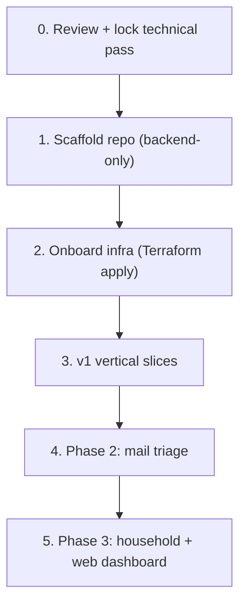

# aivo — Roadmap / Next Steps (Draft)

> Status: **draft for review**. Ties together [`concept.md`](concept.md) and the
> technical pass ([`data-model.md`](data-model.md),
> [`technical-overview.md`](technical-overview.md),
> [`deployment.md`](deployment.md)). Each build step maps to a homectl-reference
> skill where one applies.

## Where we are

- Concept locked ([`concept.md`](concept.md)).
- Technical pass drafted (this set of docs) — **needs your review**.
- No code, no infra yet.

## Sequence

### 0. Review + lock the technical pass (now)
Resolve the open questions across the three docs — notably: pgvector in v1?,
YouTube OAuth callback option A vs B, transcript source, in-process scheduler.
Lock decisions before scaffolding.

### 1. Scaffold the repo (backend-only)
Use the homectl **`scaffold-new-app`** skill, but trimmed: **no `frontend/`**,
no homectl-auth in v1. Lay out `backend/src/{config,db,discord,agent,tools,youtube,llm,scheduler}`,
`migrations/`, plus `Dockerfile`, `docker-compose.yml`, `k8s/deployment.yml`,
`.github/workflows/{ci.yaml,deploy.yml}`, `.env.example`, `.npmrc.example` from
the templates. Adopt the Zod env + pg/Kysely + migrations-at-boot + `/health`
patterns.
- Skills: `scaffold-new-app`, `add-postgres-database`, `local-dev-stack`.

### 2. Onboard infrastructure
Add `aivo = { postgres = true }` to the `applications` map in `homectl-infra`,
`terraform plan` / `apply` (user-approved), create the hand-managed `aivo-secrets`,
register the Discord app + bot token, set up the YouTube OAuth client, and add the
GitHub Actions deploy secrets. Wire the CI/deploy workflows and do a first
`kubectl apply`.
- Skills: `onboard-app-infrastructure`, `deploy-app`.

### 3. v1 vertical slices (build order)
Smallest useful slice first, each shippable on its own:

1. **Agent + memory + persona.** Discord `#chat` round-trip, JIT user, Zod env,
   `messages`/`memories`, "what do you remember about me?" / "forget that".
   Conversational onboarding writes the first `profiles` row.
2. **Cost control spine.** `llm_usage` ledger, `budget_config`, model tiering,
   spend report, graceful degradation, approval gate, provider-side spend limit.
   (Build early so everything after is metered.)
3. **YouTube daily digest.** Subscriptions ingest → two-stage filter → `#youtube`
   delivery (cap ~8–10) with TL;DW + "why" → buttons + freeform feedback →
   profile updates → cold-start rejected-list calibration with auto-taper.
   Scheduler fires at the configured hour.
4. **Reminders.** User-set reminders delivered proactively via the scheduler.

### 4. Phase 2 — Mail triage (read-only)
Reuse the YouTube pattern: `mail_importance` profile, importance classification
(cheap model), immediate alerts on important mail, end-of-day summary, button +
freeform feedback, asymmetric over-alerting at cold start. New `#mail` channel.

### 5. Phase 3+ — Household + web dashboard
Per-person attribution/profiles (the `users` table already supports this), then a
web dashboard — the point at which **homectl-auth** is integrated (the
`users.auth_sub` seam is already reserved). Optionally revisit the Discovery lane
(official interest-based search only; scraping ruled out).

## Decisions still open (carried from the docs)

- Semantic memory (pgvector) in v1 or later.
- YouTube OAuth callback: ingress (option A) vs local one-time consent (option B).
- Transcript source + reliability for stage 2.
- LLM SDK / tool-calling framework choice.
- In-process scheduler vs durable job table.

## Suggested immediate action

Review the three technical docs, mark the open questions, and confirm scope for
step 1 (scaffold). Once locked, the scaffold + infra onboarding can proceed as a
single focused work session.
