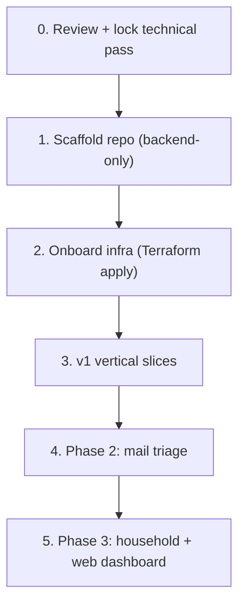

# aivo — Roadmap / Next Steps (Draft)

> Status: **reviewed — decisions locked**. Ties together [`concept.md`](concept.md) and the
> technical pass ([`data-model.md`](data-model.md),
> [`technical-overview.md`](technical-overview.md),
> [`deployment.md`](deployment.md)). Each build step maps to a homectl-reference
> skill where one applies.

## Where we are

- Concept locked ([`concept.md`](concept.md)).
- Technical pass reviewed; open questions resolved (see [Decisions (locked)](#decisions-locked)).
- No code, no infra yet.

## Sequence

### 0. Review + lock the technical pass — done
All open questions across the docs are resolved (see
[Decisions (locked)](#decisions-locked)). Ready to scaffold.

### 1. Scaffold the repo (backend-only)
Use the homectl **`scaffold-new-app`** skill, but trimmed: **no `frontend/`**,
no homectl-auth in v1. Lay out `backend/src/{config,db,discord,agent,tools,youtube,llm,scheduler}`,
`migrations/`, plus `Dockerfile`, `docker-compose.yml`, `k8s/deployment.yml`,
`.github/workflows/{ci.yml,deploy.yml}`, `.env.example`, `.env.development`,
`.npmrc.example` from the templates. Adopt the Zod env + pg/Kysely +
migrations-at-boot + `/health` patterns.
- Skills: `scaffold-new-app`, `add-postgres-database`, `local-dev-stack`.

### 2. Onboard infrastructure
Add `aivo = { postgres = true }` to the `applications` map in `homectl-infra`,
`terraform plan` / `apply` (user-approved), create the hand-managed `aivo-secrets`,
register the Discord app + bot token, set up the YouTube OAuth client, and add the
GitHub Actions deploy secrets. Wire the CI/deploy workflows and do a first
`kubectl apply`.
- Skills: `onboard-app-infrastructure`, `deploy-app`.

### 3. v1 vertical slices (build order)
Smallest useful slice first, each shippable on its own:

1. **Agent + memory + persona.** Discord `#chat` round-trip, JIT user, Zod env,
   `messages`/`memories`, "what do you remember about me?" / "forget that".
   Conversational onboarding writes the first `profiles` row.
2. **Cost control spine.** `llm_usage` ledger, `budget_config`, model tiering,
   spend report, graceful degradation, approval gate, provider-side spend limit.
   (Build early so everything after is metered.)
3. **YouTube daily digest.** — ✅ built (2026-07-02). Subscriptions ingest → two-stage
   filter → `#youtube` delivery (cap ~8–10) with TL;DW + "why" → buttons + freeform
   feedback → profile updates → cold-start rejected-list calibration with auto-taper.
   Scheduler fires at the configured hour; interval/pause/off + "run it now" are
   chat-configurable via the `youtube_digest` tool. Needs infra config to go live:
   `YOUTUBE_OAUTH_*` secrets (one-time `/youtube/oauth/start` handshake) and
   `DISCORD_YOUTUBE_CHANNEL_ID`.
4. **Reminders.** — ✅ built (2026-07-03). User-set reminders delivered proactively
   via the scheduler: `reminder` chat tool (set / list / cancel / reschedule; the
   system prompt now carries the current local date/time so natural phrasing becomes
   an absolute `due_at`), minutely due-scan in `scheduler/tick.ts` (independent of the
   YouTube lane, zero LLM cost), delivery to the home channel
   (`DISCORD_HOME_CHANNEL_ID`) with a mention + snooze buttons
   (10 min / 1 h / tomorrow 09:00 local, per-user only). Natural recurrence
   ("every other Thursday", feature-suggestions B5) is deferred — the locked data
   model has no recurrence column yet.
5. **Weather.** — ✅ built (2026-07-23). MET Norway / yr.no forecasts via the `weather`
   chat tool: forecast for any place (saved name, free-form name resolved through the
   OSM Nominatim geocoder, or explicit coordinates), per-user saved locations
   (`weather_locations` table, migration 023), and an owner-configured daily morning
   report pushed to the home channel by the scheduler tick (its schedule lives in the
   `weather` lane of `settings.proactivity`, watermarked once per local day, with a
   chat-set "run it now"). Keyless APIs — needs only `WEATHER_USER_AGENT` (their terms
   require a descriptive UA + contact); base URLs are overridable.

### 4. Phase 2 — Mail triage (read-only)
Reuse the YouTube pattern: `mail_importance` profile, importance classification
(cheap model), immediate alerts on important mail, end-of-day summary, button +
freeform feedback, asymmetric over-alerting at cold start. New `#mail` channel.

### 5. Phase 3+ — Household + web dashboard
Per-person attribution/profiles (the `users` table already supports this), then a
web dashboard — the point at which **homectl-auth** is integrated (the
`users.auth_sub` seam is already reserved). Optionally revisit the Discovery lane
(official interest-based search only; scraping ruled out).

**Dashboard scope (detailed):** [`phase-3-web-dashboard-prd.md`](phase-3-web-dashboard-prd.md)
— read-first web UI for LLM usage charts, model/pricing inspection, memory explorer,
digest history, and activity log. Discord remains the control plane; the dashboard is
for inspection and trust. Separate `frontend/` workspace, **one Docker image** with the
backend (same homectl pattern as workbench; `replicas: 1` / `Recreate` unchanged).
Recommended build order: auth shell → usage & budget → models → memory → overview →
digests/activity.

**Status:** M0 (auth shell — homectl-auth wiring, `users.auth_sub` linking, owner-only
gate, SPA shell) and M1 (usage & budget — burn-down, daily series, drivers, budget
state) — ✅ built (2026-07-03). M2+ (models, memory, overview, digests/activity,
polish) not started. To go live the app still needs infra config: register `aivo` in
homectl-auth `apps.json`, generate the client secret pair, and add `APP_BASE_URL` +
`AIVO_CLIENT_SECRET` to `aivo-secrets`.

## Decisions (locked)

- **Semantic memory:** simple category/recency/keyword retrieval in v1; pgvector deferred.
- **YouTube OAuth callback:** option A — minimal ingress at `aivo.homectl.no`.
- **Transcript source:** transcript library + metadata-only fallback for missing tracks (ToS-gray; revisit).
- **LLM SDK:** official OpenAI SDK via `LLM_BASE_URL`, hidden behind the `llm/` provider interface; in-house tool-calling.
- **Scheduler:** in-process `node-cron`, polling for due work (no durable job table in v1).
- **History retention:** retain full chat history in v1; roll-up before household.
- **Budget granularity:** per-user; YouTube cost attributed to the owner.
- **Household YouTube digest:** YouTube stays a single owner-connected account permanently — household members share the owner's digest; no second account, no per-user YouTube fan-out.
- **Resource limits:** keep 384Mi/768Mi; revisit on OOMKills.
- **Alerting:** Discord-only in v1.

## Suggested immediate action

Decisions are locked. Proceed to step 1 (scaffold the backend-only repo); the
scaffold + infra onboarding can run as a single focused work session.
