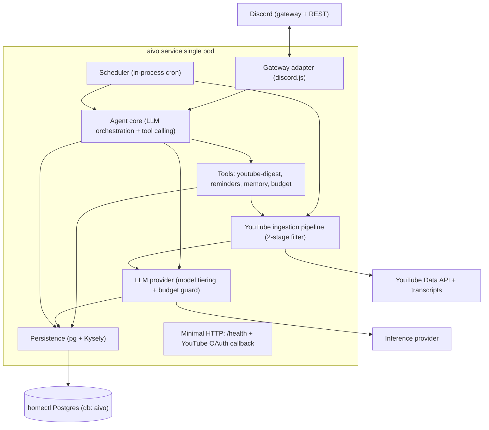
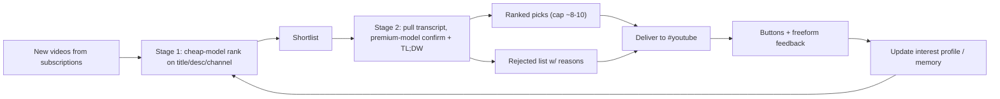

# aivo — Technical Overview (Draft)

> Status: **reviewed — decisions locked** (technical pass). Companion to
> [`concept.md`](concept.md), [`data-model.md`](data-model.md), and
> [`deployment.md`](deployment.md). Drawn from the homectl-reference platform
> docs and the canonical `workbench` app.

## What aivo is, technically

A **single long-running Node 24 / TypeScript service** that:

1. holds a persistent **Discord gateway** (WebSocket) connection and acts on
   messages, reactions, and slash commands;
2. runs an **agent core** that talks to an LLM with tool-calling;
3. runs an **in-process scheduler** for proactive work (the ~07:00 digest,
   reminder delivery);
4. persists everything to the shared homectl **Postgres**.

This is the defining divergence from the canonical `workbench` app: aivo has
**no SPA frontend and is not request/response-driven**. Discord is the entire
user interface. The only HTTP surface is `/health` (k8s probes) and a one-time
YouTube OAuth callback. Everything else is event- and timer-driven.

## Reuse vs. diverge (against `workbench`)

Reused from the homectl platform as-is:

- **Postgres + Kysely + migrations-at-boot** (application-pattern #3): `pg` Pool,
  typed Kysely, plain-SQL migrations run under an advisory lock at startup.
- **Zod-validated env at boot** that fails fast (mirror
  `workbench/backend/src/config/env.ts`).
- **Single two-stage Node 24 alpine Dockerfile**, non-root `appuser`, port 8080,
  `/health` endpoint, private `@gagnatdev/*` installs via Docker build secret.
- **Naming / secrets / CI conventions** (app id `aivo` is load-bearing: DB, user,
  secret prefix, k8s names).

Deliberately different:

- **No frontend build** — drop the `frontend/` workspace; the image ships only
  the backend + migrations. No Vite, no SPA serving.
- **No homectl-auth (browser OAuth) in v1** — identity is the Discord user id.
  We keep the JIT-user seam (`users.auth_sub` nullable) so homectl-auth can be
  added when a web dashboard appears (phase 3), but v1 needs no auth service.
- **`replicas: 1` + `Recreate` deploy strategy** — exactly one gateway
  connection and one scheduler must exist; rolling deploys / HPA would double
  them. See [`deployment.md`](deployment.md).
- **Long-lived process, not autoscaled** — readiness is "gateway connected & DB
  reachable," not "can serve HTTP."

## Component architecture

### Gateway adapter
Wraps `discord.js`. Receives messages/reactions/commands, normalizes them, does
JIT user provisioning (Discord id → `users` row), and routes to the agent core.
Sends replies and attaches reaction buttons to digest entries. Per-channel
mapping: `#chat`, `#youtube` (digest + feedback), `#mail` (phase 2).

### Agent core
The single conversational agent. Builds context (recent `messages`, relevant
`memories`, current `profiles`, persona prompt), calls the LLM with a tool
schema, and executes returned tool calls. Enforces **bounded proactivity**: it
only initiates messages from defined capabilities (digest, reminders), never
open-ended pings.

### Tools
Capabilities exposed to the agent as tools (keeps the "one assistant, many
tools" model):

- `youtube-digest` — trigger/inspect digests, apply feedback to the profile.
- `reminders` — create/list/cancel reminders.
- `memory` — read/write/forget `memories`; "what do you remember about me?".
- `budget` — report spend, set caps, change model tier.

### Scheduler
In-process timer (e.g. `node-cron`) since there is exactly one replica. Fires the
daily digest at the user's configured local hour and delivers due reminders.
Idempotent: each run records a `digests.run_date` watermark so a restart mid-day
doesn't double-send. (CronJob alternative discussed in
[`deployment.md`](deployment.md); in-process is recommended.)

### YouTube ingestion pipeline (the v1 centerpiece)
Two-stage filter from [`concept.md`](concept.md):

- **Subscriptions-only** in v1 via the YouTube Data API (free, quota-capped).
- Stage 1 ranks metadata with the **cheap** model; Stage 2 pulls transcripts and
  uses the **premium** model only for the shortlist.
- Discovery beyond subscriptions and yt-dlp scraping are **ruled out** for now
  (ToS / no supported API) per the concept.

### LLM provider abstraction (cost control lives here)
A thin provider interface that every LLM call goes through, implementing the
concept's first-class cost controls. Implemented with the **official OpenAI SDK
pointed at `LLM_BASE_URL`** (OpenAI-compatible endpoints) and wrapped so the
provider/model can be swapped without touching callers; tool-calling is
orchestrated in-house against this interface (no heavier agent framework):

- **Model tiering** — cheap model for stage-1 ranking / classification; premium
  only for TL;DW summaries + real conversation; chat-overridable.
- **Budget enforcement** — every call checks `budget_config` and the derived
  month-to-date / daily spend before running; writes an `llm_usage` row after.
- **Graceful degradation** — at thresholds: (1) drop to cheaper models + shorter
  summaries, (2) pause proactive work, but **always answer direct chat** with an
  "over budget" note.
- **Approval gate** — estimate cost and confirm before any one-off exceeds a
  user-set threshold.
- **Provider-side backstop** — a hard spend limit on the inference account/key so
  a bug can't run away (see [`deployment.md`](deployment.md)).

### Persistence
`pg` + Kysely against db `aivo`; schema in [`data-model.md`](data-model.md).
Migrations run at boot before the gateway connects.

## External integrations & secrets

| Integration | Used for | Secret(s) |
|-------------|----------|-----------|
| Discord | gateway + REST (the UI) | `DISCORD_BOT_TOKEN`, `DISCORD_APP_ID`, `DISCORD_GUILD_ID` |
| YouTube Data API | subscriptions + video metadata | `YOUTUBE_API_KEY` (and OAuth client for the user's subscriptions: `YOUTUBE_OAUTH_CLIENT_ID/SECRET` + stored refresh token) |
| Transcripts | stage-2 TL;DW | (transcript source / library; no paid key expected) |
| Inference provider | all LLM calls | `LLM_API_KEY` (+ provider-side spend limit) |
| Postgres | persistence | `DATABASE_URL` (from `aivo-terraform-secrets`) |

Plaintext secrets live only in the hand-managed `aivo-secrets`; `DATABASE_URL`
comes from `aivo-terraform-secrets` (never edited by hand). Full secret/env layout
in [`deployment.md`](deployment.md).

## Config & env (Zod-validated at boot)

Reuse the workbench env pattern. Notable vars: `NODE_ENV`, `DATABASE_URL`,
`DISCORD_*`, `YOUTUBE_*`, `LLM_API_KEY` + `LLM_BASE_URL` + model ids for the
cheap/premium tiers, `PORT` (8080), `OWNER_DISCORD_USER_ID`. No `AUTH_MODE` in v1
(no homectl-auth); keep the door open by leaving identity behind a small
interface.

## Repo layout (proposed)

A trimmed homectl monorepo — backend-only:

- `backend/` — `src/{config,db,discord,agent,tools,youtube,llm,scheduler}`,
  `migrations/*.sql`
- `Dockerfile`, `docker-compose.yml` (local Postgres + the service)
- `k8s/deployment.yml`, `.github/workflows/{ci.yaml,deploy.yml}`
- `.env.example`, `.env.development` (local, no real secrets), `.npmrc.example`
- `docs/` (these files)

## Local development

`docker compose up` brings up Postgres + the service; point the bot at a private
test Discord guild with a dev `DISCORD_BOT_TOKEN`. Use the cheap model tier and a
tiny budget for local runs. No auth service is needed (Discord identity only).

## Decisions (locked)

- **LLM SDK:** the official OpenAI SDK, pointed at `LLM_BASE_URL` (OpenAI-compatible
  endpoints), wrapped behind the `llm/` provider interface so the provider/model can
  be swapped without touching callers. Tool-calling is orchestrated in-house against
  that interface — no heavier agent framework.
- **Transcript source:** a transcript library (auto-generated/uploaded caption track
  for any public video) with a metadata-only fallback — when no track exists, set
  `videos.transcript_status = unavailable` and summarize from title/description at
  lower confidence rather than dropping the video. This is the unofficial/ToS-gray
  path flagged in the concept; revisit if it proves fragile.
- **YouTube OAuth:** keep a minimal ingress at `aivo.homectl.no` so the OAuth
  `redirect_uri` resolves in-cluster (option A in [`deployment.md`](deployment.md)).
- **Scheduler:** in-process `node-cron`, **polling-based** — tick ~every minute and
  query for due work (reminders where `status = pending AND due_at <= now`, and the
  `digests.run_date` watermark) rather than holding per-item in-memory timers, so the
  brief `Recreate` downtime self-heals on the next tick. No durable job table in v1.
